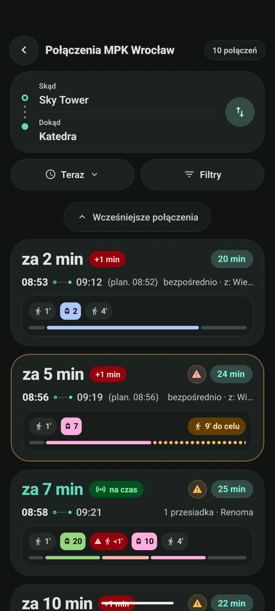
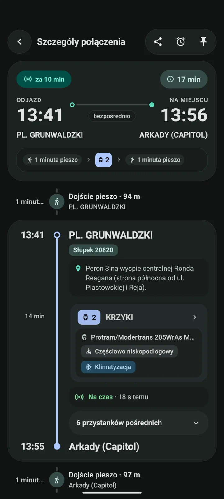
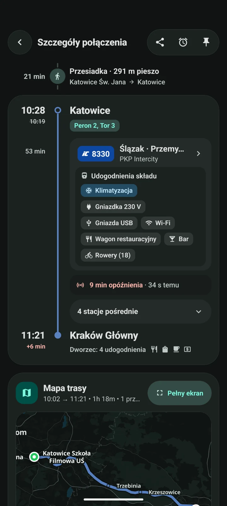
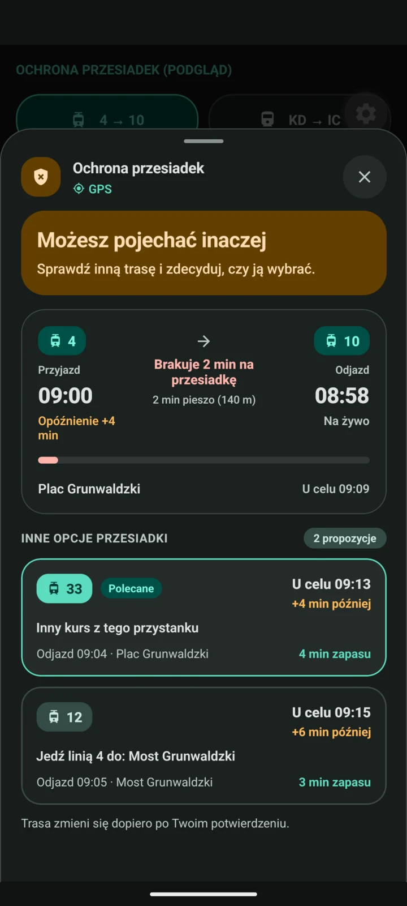

<div align="center">

<a href="https://kilometr.app">
  
</a>

<h1>Kilometr</h1>

<p><strong>Planer podróży komunikacją miejską i koleją w Polsce.</strong></p>

<p>
  <a href="https://github.com/sioodmy/kilometr/actions/workflows/ci.yml"></a>
  <a href="https://github.com/sioodmy/kilometr/releases/latest"></a>
  <a href="https://play.google.com/store/apps/details?id=app.kilometr&hl=pl-PL"></a>
  <a href="docs/fdroid.md"></a>
  <a href="LICENSE"></a>
</p>

<p>
  <a href="https://kilometr.app">Strona projektu</a> ·
  <a href="https://play.google.com/store/apps/details?id=app.kilometr&hl=pl-PL">Google Play</a> ·
  <a href="https://github.com/sioodmy/kilometr/releases/latest">Pobierz APK / IPA</a> ·
  <a href="https://buycoffee.to/sioodmy">Postaw kawę</a>
</p>

</div>

---

<div align="center">
  
  
  
  
</div>

## Co robi Kilometr

Kilometr wyznacza trasy tramwajem, autobusem, metrem, trolejbusem i pociągiem bezpośrednio na telefonie. Po pobraniu paczki rozkładów oraz mapy dla wybranego miasta wyszukiwarka działa bez zasięgu i poza siecią. Gdy połączenie z internetem jest dostępne, aplikacja dokłada pozycje pojazdów na żywo, opóźnienia kolejowe oraz komunikaty o utrudnieniach.

- **Wyszukiwanie tras na urządzeniu (`kilometr-raptor`)**: silnik Range RAPTOR napisany w Rust wyznacza połączenia lokalnie na bazie SQLite pobranej dla miasta. Uwzględnia tempo marszu, minimalny czas na przesiadkę i filtry środków transportu.
- **Ochrona przesiadek w trasie**: podczas aktywnej podróży aplikacja monitoruje zapas czasu na kolejną przesiadkę. Gdy kurs łapie opóźnienie, podpowiada alternatywne połączenia z tego samego lub sąsiedniego przystanku. Jeśli pojazd nie nadaje pozycji GPS, czas przejazdu jest szacowany na podstawie lokalizacji telefonu.
- **Kolej dalekobieżna i regionalna**: rozkłady PKP Intercity, POLREGIO i przewoźników wojewódzkich (m.in. KD, KM, KŚ, KMŁ, KW, SKM, WKD, ŁKA) w jednym planerze razem z dojazdem miejskim. Widok kursu pokazuje peron, tor, opóźnienie i zestawienie wagonów.
- **Szczegóły przystanku i taboru**: numer słupka przystankowego, jednozdaniowe wskazówki lokalizacyjne (stop hints na bazie OpenStreetMap), model pojazdu, układ niskopodłogowy, klimatyzacja i wiek ostatniego odczytu GPS.
- **Mapy wektorowe offline (`kilometr-maps`)**: kafelki OpenMapTiles w pakietach `.ktp` serwowane z lokalnego silnika MapLibre, z dopasowanym ciemnym i jasnym stylem Material 3.
- **Komunikaty bez urzędowego żargonu**: automatycznie przetwarzane komunikaty ZTM/MPK pokazują skrócone podsumowanie zmian, listę dotkniętych linii i trasy zastępcze.
- **Widgety i Live Activity (`kilometr-widgets`)**: cztery natywne widgety na Androida (RemoteViews, kolory Material You z tapety) oraz iOS (SwiftUI, WidgetKit, Dynamic Island).
- **Prywatność i brak trackerów**: brak kont użytkowników, brak reklam, brak Firebase Cloud Messaging, Google Play Services Location i Install Referrer. Kopia zapasowa zapisanych miejsc i ustawień eksportuje się do zwykłego pliku JSON. Interfejs dostępny po polsku, angielsku, niemiecku i ukraińsku.

## Pobieranie

| Platforma | Kanał | Link / Artefakt |
| :--- | :--- | :--- |
| **Android** | Google Play | [`app.kilometr`](https://play.google.com/store/apps/details?id=app.kilometr&hl=pl-PL) |
| **Android** | GitHub Releases (stabilne) | [`kilometr-prod.apk`](https://github.com/sioodmy/kilometr/releases/latest/download/kilometr-prod.apk) |
| **Android** | GitHub Releases (nightly) | [`kilometr-nightly.apk`](https://github.com/sioodmy/kilometr/releases) |
| **Android** | Obtainium | Konfiguracja w [`docs/obtainium.json`](docs/obtainium.json) (filtr `^kilometr-prod\.apk$`) |
| **Android (FOSS)** | F-Droid / bez GMS | Receptura [`metadata/app.kilometr.yml`](metadata/app.kilometr.yml) oraz opis w [`docs/fdroid.md`](docs/fdroid.md) |
| **iOS** | Sideload (AltStore / Sideloadly) | [`kilometr-unsigned.ipa`](https://github.com/sioodmy/kilometr/releases/latest/download/kilometr-unsigned.ipa) |
| **Web** | Przeglądarka | [`kilometr.app`](https://kilometr.app) |

## Zasięg

Kilometr obsługuje **132 miasta i aglomeracje w Polsce** zdefiniowane w [`src/cities.ts`](src/cities.ts) oraz ogólnopolską sieć kolejową.

- **Metropolie i miasta wojewódzkie**: m.in. Wrocław, Kraków, Metropolia GZM (Katowice i 40+ miast), Warszawa, Poznań, Trójmiasto (Gdańsk, Gdynia, Sopot), Łódź, Szczecin, Bydgoszcz, Toruń, Lublin, Białystok, Rzeszów, Kielce, Olsztyn, Opole, Zielona Góra, Gorzów Wielkopolski.
- **Ośrodki regionalne**: m.in. Bielsko-Biała, Częstochowa, Radom, Rybnik, Wałbrzych, Tarnów, Płock, Koszalin, Elbląg, Kalisz, Legnica, Słupsk, Jastrzębie-Zdrój, Nowy Sącz, Konin, Piła, Suwałki, Przemyśl, Świnoujście, Zakopane i ponad 100 innych sieci miejskich.
- **Kolej**: PKP Intercity, POLREGIO, Koleje Dolnośląskie, Koleje Mazowieckie, Koleje Śląskie, Koleje Małopolskie, Koleje Wielkopolskie, Łódzka Kolej Aglomeracyjna, SKM Warszawa, SKM Trójmiasto, WKD, Arriva RP.

## Architektura

```
┌─ GitHub Actions (cron / pipeline) ──────────────────────────────────────┐
│  cloudflare/scripts/build-timetable.mjs                                 │
│  Pobiera feedy GTFS i dane kolejowe, buduje spakowane bazy SQLite       │
│  (.db.gz), pakiety kafelków mapy (.ktp), indeksy adresów/POI            │
│  oraz streszczenia komunikatów, po czym wysyła artefakty do R2.         │
└───────────────────────────────────┬─────────────────────────────────────┘
                                    ▼
┌─ Cloudflare R2 + Worker (`cloudflare/`) ────────────────────────────────┐
│  Serwuje manifesty wersji, bazy rozkładów i pakiety map z obsługą       │
│  nagłówków Range. Pozycje pojazdów live telefon odpytuje bezpośrednio   │
│  u operatorów z pominięciem proxy.                                      │
└───────────────────────────────────┬─────────────────────────────────────┘
                                    ▼
┌─ Aplikacja mobilna (Expo / React Native + moduły natywne) ──────────────┐
│  • kilometr-raptor   : silnik Range RAPTOR (Rust -> JSI / WASM)         │
│  • kilometr-maps     : lokalny serwer kafelków `.ktp` i styl MapLibre   │
│  • kilometr-tracking : śledzenie podróży na żywo, GPS i alarmy          │
│  • kilometr-widgets  : widgety Android RemoteViews i iOS WidgetKit      │
└─────────────────────────────────────────────────────────────────────────┘
```

Struktura repozytorium:

- [`app/`](app/) i [`src/`](src/): ekrany Expo Router, klient GTFS/SQLite, logika ochrony przesiadek, style mapy M3 oraz słowniki [`src/i18n/`](src/i18n/) (`pl`, `en`, `de`, `uk`).
- [`modules/kilometr-raptor/`](modules/kilometr-raptor/): natywny moduł routingu w Rust ([`Cargo.toml`](modules/kilometr-raptor/rust/Cargo.toml)) z fallbackiem WebAssembly.
- [`modules/kilometr-maps/`](modules/kilometr-maps/): obsługa paczek kafelków offline i lokalnego serwera map.
- [`modules/kilometr-tracking/`](modules/kilometr-tracking/): serwis pierwszoplanowy Androida i obsługa powiadomień o podróży.
- [`modules/kilometr-widgets/`](modules/kilometr-widgets/): natywne widgety ekranu głównego i Live Activity ([dokumentacja](modules/kilometr-widgets/README.md)).
- [`cloudflare/`](cloudflare/): skrypty budujące bazy rozkładów oraz Cloudflare Worker ([dokumentacja](cloudflare/README.md)).
- [`server/`](server/): pomocniczy serwer deweloperski GTFS / proxy używany podczas pracy lokalnej.
- [`landing/`](landing/): kod strony [`kilometr.app`](https://kilometr.app).

## Uruchomienie lokalne

Projekt używa Nix Flakes ([`flake.nix`](flake.nix)) do zapewnienia powtarzalnego środowiska z Node.js 22, Rustem i Android SDK. Można też korzystać z lokalnej instalacji Node.js 22+.

```sh
# Wejście do powłoki deweloperskiej Nix (albo nix develop .#ci dla samego Node + Rust)
nix develop

# Instalacja zależności, nałożenie łatek z patches/ i zbudowanie bundla MapLibre
npm ci

# Uruchomienie serwera Metro
npm run start
```

Weryfikacja zmian i testy celowane:

```sh
# Sprawdzenie typów TypeScript (w tym kompletności tłumaczeń pl/en/de/uk)
npm run typecheck

# Linter i testy jednostkowe
npm run lint
npm run test:unit

# Testy silnika tras, ochrony przesiadek i wariantu F-Droid
npm run check:routing
npm run check:transfers
npm run check:fdroid
```

Aby zbudować wariant F-Droid całkowicie ze źródeł (bez prekompilowanych binariów Expo i zależności GMS), zobacz instrukcję w [`docs/fdroid.md`](docs/fdroid.md).

## Źródła danych

Rozkłady jazdy, położenie pojazdów oraz komunikaty pochodzą z otwartych danych zarządców transportu miejskiego, PKP Polskich Linii Kolejowych ([Portal Pasażera](https://portalpasazera.pl)) oraz projektu [OpenStreetMap](https://www.openstreetmap.org/copyright) (kafelki wektorowe w schemacie OpenMapTiles z [OpenFreeMap](https://openfreemap.org/)). Pełny wykaz operatorów i licencji dla każdego miasta znajduje się w aplikacji w sekcji *Ustawienia -> Źródła danych*.

## Licencja

Kod źródłowy projektu jest udostępniany na licencji [GNU General Public License v3.0 lub późniejszej](LICENSE) (`GPL-3.0-or-later`).
